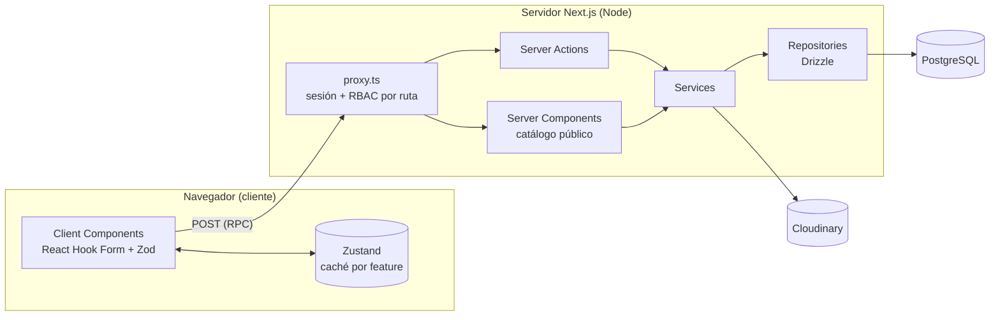
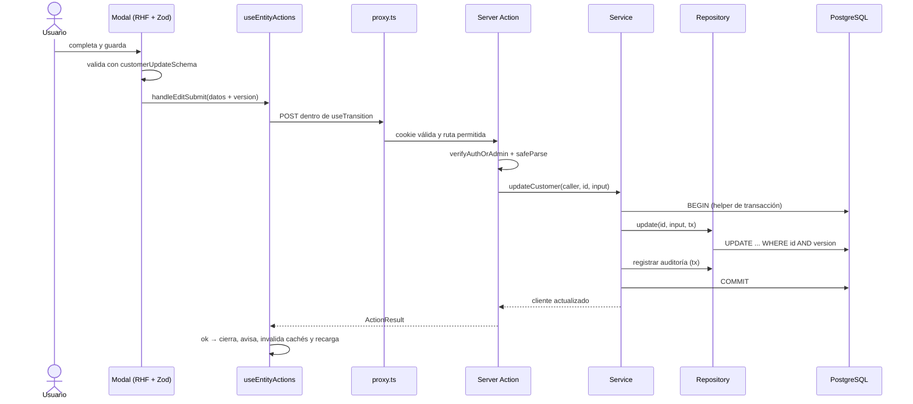

# Arquitectura

Cómo está armado el sistema, qué puede depender de qué y por qué. Las reglas duras están resumidas en
[`AGENTS.md`](../AGENTS.md); acá está el detalle.

> **Origen del código.** La base es *ArgenStock*, un sistema de stock y punto de venta para una casa de
> celulares. La arquitectura se conserva y el dominio se adapta a la rotisería (empanadas, pizzas, sándwiches y
> ciabattas) ítem por ítem del backlog. Mientras tanto conviven nombres heredados: por ejemplo, la tabla
> `devices` ("equipos") cumple el rol de **categoría** de producto.
>
> `provider` es el feature molde (T-5): ya cumple toda la arquitectura objetivo. La sección
> [Brechas](#brechas-entre-el-código-actual-y-estas-reglas) lista lo heredado que no cumple las reglas.

## Vista general

Una sola aplicación **Next.js 16 (App Router)** con dos caras:

| Cara | Rutas | Quién la usa | Cómo renderiza |
|---|---|---|---|
| Catálogo público | `/home`, `/product/[id]` | Clientes del local, sin login | Server Components con ISR (`revalidate = 30`) |
| Login | `/login` | Personal | Client Component + Server Action |
| Panel de gestión | `/` (dashboard), `/productos`, `/ventas`, `/clientes`, `/proveedores`, `/categorias`, `/usuarios`, `/logs` | `admin` y `vendedor` | Client Components + Server Actions |

**Estilo arquitectónico.** Son dos ejes distintos y valen los dos:

- **En ejecución es cliente-servidor.** El navegador renderiza los Client Components, guarda caché en Zustand y
  valida formularios. El servidor Node (Next.js) renderiza los Server Components, ejecuta las Server Actions y es
  el único que habla con PostgreSQL y Cloudinary.
- **En despliegue es un monolito modular.** Cliente y servidor salen del mismo código y se despliegan juntos.
  Adentro, el código se agrupa por *feature* (`src/features/<feature>`), no por tipo técnico.

**Cliente y servidor se comunican por Server Actions, no por una API REST propia.** Una Server Action es una
función `async` exportada desde un archivo con `'use server'`. Next.js la expone como un endpoint POST y genera
la llamada del lado cliente, así que los tipos viajan de punta a punta sin escribir contratos HTTP. Los Route
Handlers (`src/app/api/**`) quedan reservados para integraciones externas, como webhooks. Hoy no hay ninguno.



### Stack

| Capa | Tecnología |
|---|---|
| Framework | Next.js 16 (App Router, Turbopack), React 19, TypeScript `strict` |
| UI | Tailwind CSS v4, lucide-react, framer-motion, next-themes, react-virtuoso (tablas largas) |
| Estado en el cliente | Zustand, un store por feature |
| Formularios y validación | React Hook Form + Zod 4; `drizzle-zod` deriva los schemas de las tablas |
| Datos | PostgreSQL 15 + Drizzle ORM (`node-postgres`), migraciones con `drizzle-kit` |
| Autenticación | JWT HS256 (`jose`) en cookie `httpOnly`, contraseñas con `bcrypt` |
| Archivos | Cloudinary (fotos de producto recortadas a 1:1 al subir) |
| Comprobantes | `window.print()` sobre una vista de impresión |
| Calidad | ESLint 9 (`eslint-config-next` + reglas duras en `eslint/`, con la lista `eslint-legacy.json`), Prettier, lefthook, commitlint y GitHub Actions (ADR 0003) |
| Tests | Vitest 5 (unit e integración), fast-check y Playwright (E2E). Testing Library y Stryker **(a instalar, T-5)**. Ver [`testing.md`](testing.md) |

## Reglas de dependencia

Capas, de afuera hacia adentro. Ninguna se saltea ni se invierte:

```
ui (src/app, features/*/ui) → actions → services → repository → db
          ↘ store                              domain: lo usan todas
```

| Desde | Puede importar | Nunca |
|---|---|---|
| `src/app/**` (páginas y layouts) | `features/*/ui`, `features/*/actions`, `features/*/domain`, `components/`, `hooks/`, `config/`, `lib/utils` | `repository`, `services`, `@/lib/db` |
| `features/<f>/ui` | `domain` y `actions` de cualquier feature, `store` propio, `components/`, `hooks/`, `config/` | `repository`, `services`, `@/lib/db` |
| `features/<f>/store` | `domain` (sólo tipos) | `actions`, `repository`, `@/lib/db` |
| `features/<f>/actions` | `services` propios, `domain`, `lib/auth`, `lib/errors`, `lib/action-result` | `repository`, `@/lib/db`, `ui`, `store` |
| `features/<f>/services` | `repository` propio y, si la operación los abarca, repositorios de otros features (una venta descuenta stock); `domain`, `lib/errors`, el helper de transacción de `lib/db` | `actions`, `ui`, `store`, `next/*` (`cookies`, `headers`) |
| `features/<f>/repository` | `@/lib/db`, `@/lib/db/schema`, `drizzle-orm`, tipos de `domain`, `lib/errors` | `services`, `actions`, `next/*` |
| `features/<f>/domain` | `zod`, `drizzle-zod`, `@/lib/db/schema` (sólo para derivar schemas) | `@/lib/db` (la conexión), `repository`, `next/*` |
| `src/components/**` | otros `components/`, `lib/utils` | `features/*` |
| `src/lib/**` | librerías externas, otros módulos de `lib/` | `features/*` |

Por qué:

- **El navegador nunca importa código con acceso a datos.** `@/lib/db` abre un pool de `pg` con credenciales.
  `lib/db/index.ts` lleva `import 'server-only'` (T-4) para que el build falle si un Client Component lo importa, y
  con él cualquier repositorio o service que lo use. Los scripts `db:*` y el E2E, que corren fuera de Next, usan la
  condición `--conditions=react-server`, que resuelve `server-only` a un módulo vacío (ya configurada en los scripts
  de `package.json`). En Vitest, un alias lo reemplaza por `src/test/empty-module.ts`.
- **Las actions no llaman al repositorio.** Las reglas de negocio (stock suficiente, permisos finos,
  reactivación por DNI duplicado) tienen que poder testearse sin Next.js ni base de datos: viven en el service y
  se prueban con un repositorio fake.
- **Sólo el repositorio toca Drizzle.** Cambiar una query no obliga a tocar reglas, y los tests de integración
  se concentran en un solo lugar.

### Anatomía de un feature

```
src/features/<feature>/
  domain/       <feature>.schema.ts      Zod: entrada (create/update) y fila (row) + tipos inferidos
  repository/   <feature>.repository.ts  interfaz + Drizzle; unidad de trabajo con la transacción
  services/     <feature>.service.ts     reglas de negocio; recibe la unidad de trabajo
  actions/      <operación>.ts           'use server': auth → validación → service → ActionResult
  store/        <feature>.store.ts       Zustand: lista cacheada + isLoaded
  ui/           components/, hooks/      componentes propios del feature
  testing/      fake y suite de comportamiento   sólo para tests
```

Con el tope de 100 líneas, cuando un archivo crece se parte por operación (`create-customer.action.ts`,
`update-customer.action.ts`), como ya pasa con las fotos de producto.

## Servidor

| Ruta | Contenido |
|---|---|
| `src/proxy.ts` | Next 16 renombró `middleware.ts` a `proxy.ts`. Corre en cada request: valida la cookie `session`, redirige a `/home` si no hay sesión y aplica RBAC por ruta (el `vendedor` sólo entra a `/productos`, `/ventas` y `/clientes`). Las rutas públicas están en `publicPaths`. |
| `src/features/<f>/actions/` | Server Actions. Única puerta del cliente al servidor: sesión y rol, validación Zod, service y `ActionResult`. |
| `src/features/<f>/services/` | Reglas de negocio y orquestación. Abren la transacción y la pasan a los repositorios. Existe en `stats` (BUG-5) y en `provider` (T-5, con unidad de trabajo: el service nunca ve `tx`); en el resto de los features la lógica sigue repartida entre actions y repositorios, y se migra copiando `provider`. |
| `src/features/<f>/repository/` | Acceso a datos con Drizzle. Reciben `tx` opcional para participar de una transacción y traducen "0 filas afectadas" a error de concurrencia. |
| `src/lib/db/schema.ts` | Schema Drizzle: tablas, enums, índices, FKs y relaciones. Fuente de verdad de la base. |
| `src/lib/db/migrations/` | Migraciones SQL generadas por `drizzle-kit`. No se editan a mano. |
| `src/lib/db/index.ts` | Pool de conexión y cliente `db`. La configuración sale de `database-config.ts`: `.env.prod` sólo con `APP_ENV=production`; si no, `.env.local`. |
| `src/lib/db/scripts/` | Seeds, reset, stress test y backfills (`npm run db:*`). |
| `src/lib/auth/` | `jwt.ts` firma y verifica tokens con `jose`. `utils.ts` expone `verifyAuthOrAdmin`, que valida el token, vuelve a leer al usuario de la base (tiene que seguir activo) y controla el rol. |
| `src/lib/audit-logs.ts` | `recordAuditLog`: registra cada mutación dentro de la misma transacción. |
| `src/lib/db-errors.ts` | Traducción de errores a código y mensaje: `databaseErrorCode` (23505 → `DUPLICATE`; 23503 → `RELATION_NOT_FOUND` al insertar o `HAS_RELATIONS` al borrar; `Failed query` → `STALE_VERSION`), `handleDatabaseError` (texto, para el código heredado) y `toActionFailure` (`ActionResult` con `code`, para el código nuevo; nunca filtra el mensaje de un error desconocido). Lee el error original también en `error.cause`, donde lo deja Drizzle 0.45 (BUG-9). |
| `src/lib/db/transaction.ts` | `withTransaction(work)` y el tipo `DbTransaction`: el único acceso a la transacción que pueden usar los services. |
| `src/lib/format-date-time.ts` | `formatDateTime(fecha)`: `DD/MM/AAAA, HH:mm` en `America/Argentina/Buenos_Aires`; "—" si la fecha no es válida. |
| `src/lib/cloudinary.ts` | Subida y borrado de fotos. |
| `src/scripts/` | Mantenimiento de la base (`enable-unaccent`). |

## Cliente

| Ruta | Contenido |
|---|---|
| `src/app/layout.tsx`, `src/app/providers.tsx` | Layout raíz, fuente, tema claro/oscuro (next-themes) e inicializador de sesión. |
| `src/app/(auth)/` | Pantalla de login. |
| `src/app/(main)/` | Panel de gestión: layout con menú según el rol y una carpeta por pantalla (`page.tsx` + `*-panel.tsx`). |
| `src/app/home/`, `src/app/product/` | Catálogo público y ficha de producto. Las páginas son Server Components; los filtros y la paginación son componentes cliente. |
| `src/features/<f>/ui/` | Componentes y hooks del feature: modales de formulario, POS, carrito, pagos, descuentos. |
| `src/features/<f>/store/` | Store Zustand del feature, con nombre en singular (`useCustomerStore`). |
| `src/stores/index.ts` | `invalidateAllCaches()` marca todos los stores como no cargados después de una mutación. |
| `src/hooks/` | `useEntityManager` (modales, búsqueda, mensajes) y `useEntityActions` (CRUD genérico con `useTransition`, refetch e invalidación). |
| `src/components/ui/` | Componentes genéricos sin lógica de negocio: botón, modal, tabla virtualizada, toolbar, skeleton, alertas. |
| `src/components/contact/`, `src/lib/contact/` | Botones de contacto del catálogo (WhatsApp e Instagram) con el mensaje armado. |
| `src/config/tables/`, `src/config/cards/` | Columnas de tabla (desktop) y tarjetas (mobile) por entidad. |
| `src/config/messages.ts` | Mensajes de éxito y error en español. |
| `src/constants/test-ids.ts` | `data-testid` compartidos entre la UI y los tests E2E. |

## Compartido (cliente y servidor)

| Ruta | Contenido |
|---|---|
| `src/features/<f>/domain/` | Schemas Zod y tipos inferidos: `*CreateSchema` (entrada), `*UpdateSchema` (parcial + `version`) y `*RowSchema` (lo que devuelve el servidor). El formulario y la action validan con el **mismo** schema. |
| `src/lib/action-result.ts` | `ActionResult<T>`: resultado tipado de toda action. Éxito con `data` y `message`, o fallo con `error` (texto en español) y `code` del catálogo. `code` es opcional para no romper el código heredado; el código nuevo arma el fallo con `fail(code)` o `toActionFailure(error)`. |
| `src/lib/utils.ts`, `src/lib/zod-helpers.ts` | Utilidades puras: normalización para búsqueda, slugs, helpers de Zod. |
| `src/lib/errors/` | Catálogo de códigos (`codes.ts`: `VALIDATION`, `UNAUTHENTICATED`, `SESSION_EXPIRED`, `INACTIVE_USER`, `FORBIDDEN`, `NOT_FOUND`, `DUPLICATE`, `HAS_RELATIONS`, `RELATION_NOT_FOUND`, `STALE_VERSION`, `UNEXPECTED`), `AppError(code)` con su mensaje en español (los mismos textos que ya veía el usuario) y los errores heredados `ConcurrencyError` y `DuplicateEntityError`. `verifyAuthOrAdmin` lanza `AppError` (T-4). El cliente puede reaccionar por `code` en vez de comparar textos. |

## Flujo de una petición

### Mutación desde el panel (ejemplo: editar un cliente)

El diagrama muestra el flujo objetivo. Hoy la action hace también el trabajo del service.



1. **El cliente valida** con el schema de `domain` para dar feedback inmediato. No es una medida de seguridad.
2. **`proxy.ts` filtra** por sesión y por ruta. Es una barrera de navegación, **no** de seguridad: una Server
   Action se puede invocar con un POST armado a mano.
3. **La action es la barrera real.** Verifica sesión y rol contra la base y vuelve a validar la entrada.
4. **El service aplica las reglas** y abre la transacción. La auditoría se escribe en la **misma** transacción:
   si falla una de las dos, no queda ninguna.
5. **La action nunca lanza hacia el cliente.** Devuelve `ActionResult`. Los errores conocidos llevan su mensaje
   en español; los desconocidos se loguean en el servidor y el cliente recibe un mensaje genérico.
6. **El cliente refresca**: ante error lo muestra en el modal; ante éxito invalida todas las cachés y vuelve a
   pedir la lista.

### Lectura en el panel

Al montar, el panel mira `isLoaded` en su store. Si es `false`, llama a `fetchX()` (Server Action), que valida
la sesión, lee del repositorio y **parsea las filas con `*RowSchema`** antes de devolverlas, de modo que la forma
de la respuesta está garantizada. La lista queda en el store hasta la próxima invalidación o hasta que el usuario
toca "Sincronizar". La búsqueda y los filtros se resuelven en memoria del cliente. La excepción es la auditoría,
que se pagina y busca en el servidor con `unaccent`.

### Catálogo público

`/home` y `/product/[id]` son Server Components: leen sin sesión los productos con `show_on_landing = true` y se
regeneran cada 30 segundos (ISR). No hay carrito ni pedidos online: el cliente consulta por WhatsApp o Instagram.

## Concurrencia optimista

Problema que resuelve: dos personas editan lo mismo y la segunda pisa los cambios de la primera sin enterarse
(*lost update*).

| Pieza | Cómo funciona |
|---|---|
| Columna | `version integer not null default 1` en toda tabla que recibe `UPDATE`: `users`, `devices`, `providers`, `customers`, `products`. |
| Lectura | El `*RowSchema` incluye `version` y el cliente la guarda con la fila. |
| Escritura | El `*UpdateSchema` exige `version`. El repositorio filtra `WHERE id = :id AND version = :version` y suma 1 a `version`. |
| Conflicto | 0 filas afectadas ⇒ `ConcurrencyError` (objetivo: `AppError('STALE_VERSION')`) ⇒ "Los datos en el servidor han cambiado. Por favor, sincroniza la lista e intenta nuevamente." |
| Resolución | El usuario sincroniza y vuelve a editar sobre datos frescos. No hay merge automático. |

Casos especiales:

- **Stock.** La venta descuenta con un `UPDATE` atómico condicional (`stock = stock - q` sólo si
  `stock >= q`), sin depender de la versión que tenga el cliente: dos vendedores pueden vender el mismo producto
  a la vez mientras alcance. La venta también incrementa la `version` del producto, así que quien lo estaba
  editando recibe conflicto (test E2E "Venta vs Edición de Producto").
- **Anulación de una venta.** Bloquea la fila con `SELECT … FOR UPDATE` para evitar una doble anulación y
  repone el stock.
- **Tablas append-only** (`sales`, `sale_items`, `sale_payments`, `product_losses`, `product_images`,
  `audit_logs`). No llevan `version`: se insertan y, a lo sumo, se borran enteras.
- **Bajas.** Si una entidad participó de una venta, no se borra: se desactiva (`is_active = false`). Las FKs
  sin `onDelete` hacen que Postgres rechace el borrado físico (23503) como red de seguridad.

## Seguridad

| Tema | Implementación |
|---|---|
| Autenticación | Usuario y contraseña (`bcrypt`). Token JWT HS256 de 24 h en la cookie `session` (`httpOnly`, `secure`, `sameSite=lax`). |
| Fuerza bruta | 5 intentos fallidos por usuario ⇒ bloqueo de 15 minutos. El contador vive en la memoria del proceso: se pierde al reiniciar y no se comparte entre instancias. |
| Roles | `admin` (todo) y `vendedor` (productos, ventas y clientes). Se aplican dos veces: por ruta en `proxy.ts` y por operación en cada Server Action. |
| Sesiones viejas | `verifyAuthOrAdmin` vuelve a leer al usuario: si lo desactivaron, la sesión deja de servir aunque el JWT siga vigente. |
| Entrada | Toda action valida con Zod antes de tocar datos. Objetivo: `z.strictObject`, que rechaza campos de más. |
| Salida | Las lecturas se parsean con `*RowSchema`. `password_hash` nunca sale del servidor. |
| Auditoría | Cada mutación y cada login quedan en `audit_logs` con usuario, entidad, id y detalle en JSON. |
| Secretos | Viven en `.env.local` y `.env.prod`, ignorados por git. Toda variable nueva va a `.env.example`. `JWT_SECRET` es obligatoria: sin ella no se firman ni se verifican sesiones (BUG-2). |

## Datos

| Tabla | Qué guarda | `version` | Baja |
|---|---|---|---|
| `users` | Personal con rol `admin` o `vendedor` | Sí | Lógica (`is_active`) |
| `devices` | Categorías de producto (nombre heredado) | Sí | Lógica |
| `providers` | Proveedores | Sí | Lógica |
| `customers` | Clientes; DNI único, comparado sin puntos ni guiones | Sí | Lógica |
| `products` | Categoría, proveedor, precio de compra y de venta, stock y visibilidad en el catálogo | Sí | Física si no tiene ventas |
| `product_images` | Fotos en Cloudinary | No | Física |
| `product_losses` | Mermas: cantidad y motivo | No | — |
| `sales`, `sale_items`, `sale_payments` | Venta; renglones con el costo unitario congelado al vender; pagos en `efectivo` o `transferencia` | No | Anulación (borrado y reposición de stock) |
| `audit_logs` | Bitácora de operaciones | No | — |

Convenciones:

- Claves `uuid` generadas por Postgres (`gen_random_uuid()`), con `created_at` y `updated_at`.
- Dinero en `numeric(10,2)`. Drizzle lo devuelve como string y el `*RowSchema` lo convierte a número.
- Búsquedas sin distinguir acentos con la extensión `unaccent`, que la migración `0005_enable-unaccent` habilita en
  toda base que migre (`npm run db:enable-unaccent` queda como alternativa manual).
- Fechas: se guardan y viajan en UTC y se muestran en `America/Argentina/Buenos_Aires` con un único
  `formatDateTime` (`src/lib/format-date-time.ts`, T-4). El código heredado todavía usa `toLocaleString('es-AR')` sin
  zona (brecha de fechas).
- Cambio de schema: editar `schema.ts` → `npm run db:generate -- --name <descripcion>` → revisar el SQL generado
  → `npm run db:migrate`.

## Entornos

| Entorno | Base | Configuración | Notas |
|---|---|---|---|
| Desarrollo | Docker `db` (postgres:15, puerto 5433 en el host, para no chocar con otros Postgres locales) | `.env.local`: `LOCAL_DATABASE_URL`, `JWT_SECRET`, `CLOUDINARY_URL` | `next.config.ts` fija `turbopack.root` en la carpeta del proyecto, para que un lockfile suelto en una carpeta superior no cambie la raíz (BUG-4). Si el repo está dentro de OneDrive, la sincronización de `node_modules` y `.next` hace lento el primer compilado de cada página. |
| Tests | Docker `db-test` (postgres:15, puerto 5434 en el host, `tmpfs`, perfil `test`) | `.env.test` (versionado: sólo apunta a `db-test`) | Base descartable. Nunca la de desarrollo. Ver [`testing.md`](testing.md#bases-de-datos). |
| Producción | Supabase (pooler, SSL) | `APP_ENV=production` + `.env.prod` (`DATABASE_URL`) | Un workflow de GitHub Actions la consulta a diario para que Supabase no la suspenda. El hosting de la app está a definir: tiene que definir `APP_ENV=production` y `DATABASE_URL`. |

**Qué base se usa** ([ADR 0002](adr/0002-la-base-se-elige-con-app-env.md)). `src/lib/db/database-config.ts` decide
en función de `APP_ENV`, nunca de `NODE_ENV`. Con `APP_ENV=production` carga `.env.prod`, usa `DATABASE_URL` y
activa SSL. Con cualquier otro valor (vacío, `development` o `test`) carga `.env.local` y usa `LOCAL_DATABASE_URL`,
que es obligatoria y no tiene valor por defecto. Un valor desconocido de `APP_ENV` es un error. Así, `next build`
y `next start`, que corren con `NODE_ENV=production`, usan la base local o la que indique `LOCAL_DATABASE_URL`.

> **Cuidado.** Los scripts `db:*` usan `.env.prod` si `APP_ENV=production`, y `db:seed` / `db:reset-data`
> **borran todas las tablas, usuarios incluidos**. Desde BUG-3, `db:seed`, `db:reset-data` y `db:reset-full` se
> niegan a correr con `APP_ENV=production` o contra una base que no sea local (`assert-safe-to-wipe.ts`). `wipe-db.ts`
> y `db:seed-users` todavía no tienen esa guarda (BUG-10).

## Mobile (Capacitor)

No aplica por ahora. El panel y el catálogo son responsive y mobile-first: tablas en desktop y tarjetas en
mobile (`ResponsivePanelView`). Si aparece la necesidad de una app instalable (impresora térmica, notificaciones,
uso sin conexión), se decide con un ADR que evalúe primero una PWA y después Capacitor.

## Brechas entre el código actual y estas reglas

El código heredado **no se copia como ejemplo**. Cada brecha se corrige cuando un ítem del backlog toca ese
código, o con un ítem propio. Nunca "de paso" dentro de otra tarea.

El inventario exacto de archivos que violan las reglas duras es `eslint-legacy.json` (143 al activarlas en T-3).
Cuando un ítem corrige uno, lo saca de la lista, y la lista nunca crece (ADR 0003).

| Brecha | Dónde | Regla de `AGENTS.md` |
|---|---|---|
| No existe la capa `services`: la lógica de negocio está en actions y repositorios | Todos los features | Capas |
| `lib/` importa de `features/` | `lib/auth/utils.ts`, `lib/audit-logs.ts` | Capas |
| `sql` de Drizzle dentro de queries (unaccent, normalización de DNI, `version + 1`, `NOW()`): unas 54 líneas | Repositorios | SQL |
| `any` / `as any`: unos 116 usos | Repositorios, actions, stats | Tipado |
| Errores como textos (`MESSAGES` + `handleDatabaseError`), sin catálogo `AppError(code)` | `lib/`, actions | Errores |
| Activar/desactivar y borrar no filtran por `version` | `updateActiveStatus`, `delete*` de los repositorios | Concurrencia |
| 50 de 142 archivos de `src/` superan las 100 líneas, y hay comentarios en todo el código | POS, dashboard, schema, paneles… | Tope de líneas, Comentarios |
| Fechas como `timestamp` sin zona; se formatean con `toLocaleString('es-AR')` sin fijar la zona; el dashboard arma los rangos con la hora local del servidor | `schema.ts`, `stats.actions.ts`, paneles | Fechas |
| Dependencias sin uso: `pino`, `jsonwebtoken`, `@supabase/supabase-js`, `jspdf`, `html2canvas` | `package.json` | — |
| Textos, metadata SEO y datos de contacto de ArgenStock (accesorios Apple, teléfono e Instagram del cliente anterior) | `app/layout.tsx`, `app/home/page.tsx`, `lib/contact/contact.config.ts`, seed | — |
