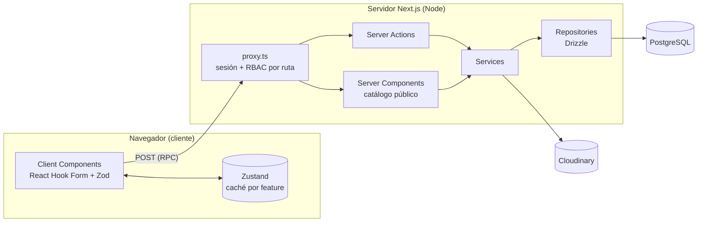
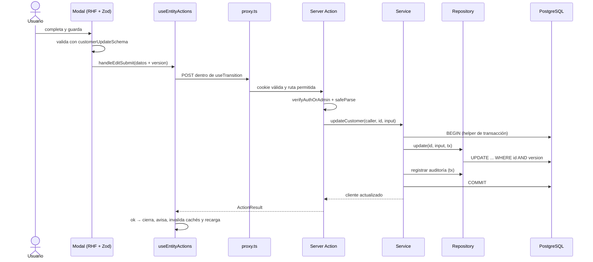

# Arquitectura

Cómo está armado el sistema, qué puede depender de qué y por qué. Las reglas duras están resumidas en
[`AGENTS.md`](../AGENTS.md); acá está el detalle.

> **Origen del código.** La base es *ArgenStock*, un sistema de stock y punto de venta para una casa de
> celulares. La arquitectura se conserva; el dominio ya es el de Empanadería Isabela: desde T-12 (Sprint 1) no
> quedan tablas, pantallas ni datos del modelo viejo, y un test (`src/test/no-legacy-words.test.ts`) lo vigila.
>
> `provider` es el feature molde (T-5): ya cumple toda la arquitectura objetivo. La sección
> [Brechas](#brechas-entre-el-código-actual-y-estas-reglas) lista lo heredado que no cumple las reglas.

## Vista general

Una sola aplicación **Next.js 16 (App Router)** con dos caras:

| Cara | Rutas | Quién la usa | Cómo renderiza |
|---|---|---|---|
| Catálogo público | `/home`, `/product/[id]` | Clientes del local, sin login | Server Components: `/home` estática con revalidación a demanda ([ADR 0004](adr/0004-revalidacion-a-demanda-del-catalogo.md)); `/product/[id]` dinámica |
| Login | `/login` | Personal | Client Component + Server Action |
| Panel de gestión | `/` (Estadísticas), `/gastos`, `/ventas` (Ventas/Pedidos), `/ventas/nueva` (tablero), `/promociones`, `/stock`, `/alta-de-productos`, `/tarjetas`, `/clientes`, `/proveedores`, `/usuarios`, `/logs` | `admin` y `vendedor` | Client Components + Server Actions |

**Estilo arquitectónico.** Son dos ejes distintos y valen los dos:

- **En ejecución es cliente-servidor.** El navegador renderiza los Client Components, guarda caché en Zustand y
  valida formularios. El servidor Node (Next.js) renderiza los Server Components, ejecuta las Server Actions y es
  el único que habla con PostgreSQL y Cloudinary.
- **En despliegue es un monolito modular.** Cliente y servidor salen del mismo código y se despliegan juntos.
  Adentro, el código se agrupa por *feature* (`src/features/<feature>`), no por tipo técnico.

**Cliente y servidor se comunican por Server Actions, no por una API REST propia.** Una Server Action es una
función `async` exportada desde un archivo con `'use server'`. Next.js la expone como un endpoint POST y genera
la llamada del lado cliente, así que los tipos viajan de punta a punta sin escribir contratos HTTP. Los Route
Handlers (`src/app/api/**`) quedan reservados para integraciones externas, como webhooks. Hoy no hay ninguno.



### Stack

| Capa | Tecnología |
|---|---|
| Framework | Next.js 16 (App Router, Turbopack), React 19, TypeScript `strict` |
| UI | Tailwind CSS v4, lucide-react (íconos por grupo; los de Empanada y Ciabatta son propios, en `src/components/icons/`), framer-motion, next-themes, react-virtuoso (tablas largas) |
| Estado en el cliente | Zustand, un store por feature |
| Formularios y validación | React Hook Form + Zod 4; `drizzle-zod` deriva los schemas de las tablas |
| Datos | PostgreSQL 15 + Drizzle ORM (`node-postgres`), migraciones con `drizzle-kit` |
| Autenticación | JWT HS256 (`jose`) en cookie `httpOnly`, contraseñas con `bcrypt` |
| Archivos | Cloudinary (fotos de cada gusto, recortadas a 1:1 al subir) |
| Comprobantes | `window.print()` sobre una vista de impresión |
| Calidad | ESLint 9 (`eslint-config-next` + reglas duras en `eslint/`, con la lista `eslint-legacy.json`), Prettier, lefthook, commitlint y GitHub Actions (ADR 0003) |
| Tests | Vitest 5 (unit e integración), fast-check y Playwright (E2E). Testing Library y Stryker **(a instalar, T-5)**. Ver [`testing.md`](testing.md) |

## Reglas de dependencia

Capas, de afuera hacia adentro. Ninguna se saltea ni se invierte:

```
ui (src/app, features/*/ui) → actions → services → repository → db
          ↘ store                              domain: lo usan todas
```

| Desde | Puede importar | Nunca |
|---|---|---|
| `src/app/**` (páginas y layouts) | `features/*/ui`, `features/*/actions`, `features/*/domain`, `components/`, `hooks/`, `config/`, `lib/utils` | `repository`, `services`, `@/lib/db` |
| `features/<f>/ui` | `domain` y `actions` de cualquier feature, `store` propio, `components/`, `hooks/`, `config/` | `repository`, `services`, `@/lib/db` |
| `features/<f>/store` | `domain` (sólo tipos) | `actions`, `repository`, `@/lib/db` |
| `features/<f>/actions` | `services` propios, `domain`, `lib/auth`, `lib/errors`, `lib/action-result` | `repository`, `@/lib/db`, `ui`, `store` |
| `features/<f>/services` | `repository` propio y, si la operación los abarca, repositorios de otros features (una venta descuenta stock); `domain`, `lib/errors`, el helper de transacción de `lib/db` | `actions`, `ui`, `store`, `next/*` (`cookies`, `headers`) |
| `features/<f>/repository` | `@/lib/db`, `@/lib/db/schema`, `drizzle-orm`, tipos de `domain`, `lib/errors` | `services`, `actions`, `next/*` |
| `features/<f>/domain` | `zod`, `drizzle-zod`, `@/lib/db/schema` (sólo para derivar schemas) | `@/lib/db` (la conexión), `repository`, `next/*` |
| `src/components/**` | otros `components/`, `lib/utils` | `features/*` |
| `src/lib/**` | librerías externas, otros módulos de `lib/` | `features/*` |

Por qué:

- **El navegador nunca importa código con acceso a datos.** `@/lib/db` abre un pool de `pg` con credenciales.
  `lib/db/index.ts` lleva `import 'server-only'` (T-4) para que el build falle si un Client Component lo importa, y
  con él cualquier repositorio o service que lo use. Los scripts `db:*` y el E2E, que corren fuera de Next, usan la
  condición `--conditions=react-server`, que resuelve `server-only` a un módulo vacío (ya configurada en los scripts
  de `package.json`). En Vitest, un alias lo reemplaza por `src/test/empty-module.ts`.
- **Las actions no llaman al repositorio.** Las reglas de negocio (stock suficiente, permisos finos,
  reactivación por DNI duplicado) tienen que poder testearse sin Next.js ni base de datos: viven en el service y
  se prueban con un repositorio fake.
- **Sólo el repositorio toca Drizzle.** Cambiar una query no obliga a tocar reglas, y los tests de integración
  se concentran en un solo lugar.

### Anatomía de un feature

```
src/features/<feature>/
  domain/       <feature>.schema.ts      Zod: entrada (create/update) y fila (row) + tipos inferidos
  repository/   <feature>.repository.ts  interfaz + Drizzle; unidad de trabajo con la transacción
  services/     <feature>.service.ts     reglas de negocio; recibe la unidad de trabajo
  actions/      <operación>.ts           'use server': auth → validación → service → ActionResult
  store/        <feature>.store.ts       Zustand: lista cacheada + isLoaded
  ui/           components/, hooks/      componentes propios del feature
  testing/      fake y suite de comportamiento   sólo para tests
```

Con el tope de 100 líneas, cuando un archivo crece se parte por operación (`create-customer.action.ts`,
`update-customer.action.ts`), como en las actions de `menu`, `stock` y `order`.

## Servidor

| Ruta | Contenido |
|---|---|
| `src/proxy.ts` | Next 16 renombró `middleware.ts` a `proxy.ts`. Corre en cada request: valida la cookie `session`, redirige a `/home` si no hay sesión y aplica RBAC por ruta con **la misma lista que el menú** (`src/config/navigation.ts`, US-2): el `vendedor` sólo entra a Ventas/Pedidos, Clientes y Stock (US-31), y si pide otra sección va a `/ventas`. Con sesión, `/login` lleva al inicio de cada rol (admin: Estadísticas; vendedor: Ventas/Pedidos). Las rutas públicas están en `PUBLIC_PATHS`. |
| `src/features/<f>/actions/` | Server Actions. Única puerta del cliente al servidor: sesión y rol, validación Zod, service y `ActionResult`. |
| `src/features/<f>/services/` | Reglas de negocio y orquestación. Abren la transacción y la pasan a los repositorios. Existe en `provider` (T-5, el molde), `menu`, `stock`, `order`, `promotion`, `card` y `expense`, con unidad de trabajo: el service nunca ve `tx`. `stats` lee la jornada en una sola transacción de sólo lectura y calcula con funciones puras. En `customer`, `user` y `audit` la lógica sigue repartida entre actions y repositorios, y se migra copiando `provider`. |
| `src/features/<f>/repository/` | Acceso a datos con Drizzle. Reciben `tx` opcional para participar de una transacción y traducen "0 filas afectadas" a error de concurrencia. |
| `src/lib/db/schema.ts`, `menu-schema.ts`, `stock-schema.ts`, `order-schema.ts`, `promotion-schema.ts`, `card-schema.ts`, `expense-schema.ts` | Schema Drizzle: tablas, enums, índices, FKs, `CHECK` y relaciones. Fuente de verdad de la base. |
| `src/lib/db/migrations/` | Migraciones SQL generadas por `drizzle-kit`. No se editan a mano. |
| `src/lib/db/index.ts` | Pool de conexión y cliente `db`. La configuración sale de `database-config.ts`: `.env.prod` sólo con `APP_ENV=production`; si no, `.env.local`. |
| `src/lib/db/scripts/` | Seeds, reset, stress test y backfills (`npm run db:*`). |
| `src/lib/auth/` | `jwt.ts` firma y verifica tokens con `jose`. `utils.ts` expone `verifyAuthOrAdmin`, que valida el token, vuelve a leer al usuario de la base (tiene que seguir activo) y controla el rol. |
| `src/lib/audit-logs.ts` | `recordAuditLog`: registra cada mutación dentro de la misma transacción. |
| `src/lib/db-errors.ts` | Traducción de errores a código y mensaje: `databaseErrorCode` (23505 → `DUPLICATE`; 23503 → `RELATION_NOT_FOUND` al insertar o `HAS_RELATIONS` al borrar; `ConcurrencyError` → `STALE_VERSION`; 23502, 23514, 22P02, 22001 y 22003 → `VALIDATION`; cualquier otro `Failed query` → `UNEXPECTED`, BUG-14), `handleDatabaseError` (texto, para el código heredado) y `toActionFailure` (`ActionResult` con `code`, para el código nuevo). Ninguno filtra al navegador el mensaje ni el SQL de un error desconocido: el detalle queda en el log del servidor. Lee el error original también en `error.cause`, donde lo deja Drizzle 0.45 (BUG-9). |
| `src/lib/db/transaction.ts` | `withTransaction(work)` y el tipo `DbTransaction`: el único acceso a la transacción que pueden usar los services. |
| `src/lib/format-date-time.ts` | `formatDateTime(fecha)`: `DD/MM/AAAA, HH:mm` en `America/Argentina/Buenos_Aires`; "—" si la fecha no es válida. `argentinaDay`, `argentinaTime` y `argentinaHour` dan el día, la hora y la hora entera en Argentina, para la jornada y los turnos de Estadísticas (US-12 y US-13); `argentinaMonth` da el primer y el último día del mes, para el filtro de Gastos (US-33). |
| `src/lib/cloudinary.ts` | Subida y borrado de fotos. |
| `src/scripts/` | Mantenimiento de la base (`enable-unaccent`). |

## Cliente

| Ruta | Contenido |
|---|---|
| `src/app/layout.tsx`, `src/app/providers.tsx` | Layout raíz, fuente, tema claro/oscuro (next-themes) e inicializador de sesión. |
| `src/app/(auth)/` | Pantalla de login. |
| `src/app/(main)/` | Panel de gestión: layout con el sidebar de 240 px (`xl:w-[240px]`) (`sidebar-nav.tsx` arma el menú de cada rol con `navigationFor`) y una carpeta por pantalla (`page.tsx` + `*-panel.tsx`). |
| `src/app/home/`, `src/app/product/` | Catálogo público y ficha de producto. Las páginas son Server Components; los filtros y la paginación son componentes cliente. |
| `src/features/<f>/ui/` | Componentes y hooks del feature: modales de formulario, tablero de pedidos, cobro, comprobante. |
| `src/features/<f>/store/` | Store Zustand del feature, con nombre en singular (`useCustomerStore`). |
| `src/stores/index.ts` | `invalidateAllCaches()` marca todos los stores como no cargados después de una mutación. |
| `src/hooks/` | `useEntityManager` (modales, búsqueda, mensajes) y `useEntityActions` (CRUD genérico con `useTransition`, refetch e invalidación). |
| `src/components/ui/` | Componentes genéricos sin lógica de negocio: botón, modal, tabla virtualizada, toolbar, skeleton, alertas. |
| `src/components/contact/`, `src/lib/contact/` | Botones de contacto del catálogo (WhatsApp e Instagram) con el mensaje armado. Sin datos en `contact.config.ts` no se muestran. |
| `src/config/brand.ts`, `src/components/brand/` | Marca de Empanadería Isabela: nombre, descripciones y `BrandLogo` (sidebar, login, catálogo). El ícono de la pestaña es `src/app/icon.png` y el logo, `public/brand/logo-isabela.png`, generados del jpeg de `docs/wireframes-ventas-gestor/`. |
| `src/app/globals.css` (`@theme`) | Paleta de la marca: `brand-50…950` (ámbar del logo), `ink` y `cream`. El acento de la UI usa `brand-*`; `src/test/brand-contrast.test.ts` verifica el contraste AA de los pares que usa la UI. |
| `src/config/tables/`, `src/config/cards/` | Columnas de tabla (desktop) y tarjetas (mobile) por entidad. |
| `src/config/messages.ts` | Mensajes de éxito y error en español. |
| `src/constants/test-ids.ts` | `data-testid` compartidos entre la UI y los tests E2E. |

## Compartido (cliente y servidor)

| Ruta | Contenido |
|---|---|
| `src/features/<f>/domain/` | Schemas Zod y tipos inferidos: `*CreateSchema` (entrada), `*UpdateSchema` (parcial + `version`) y `*RowSchema` (lo que devuelve el servidor). El formulario y la action validan con el **mismo** schema. |
| `src/lib/action-result.ts` | `ActionResult<T>`: resultado tipado de toda action. Éxito con `data` y `message`, o fallo con `error` (texto en español) y `code` del catálogo. `code` es opcional para no romper el código heredado; el código nuevo arma el fallo con `fail(code)` o `toActionFailure(error)`. |
| `src/lib/utils.ts`, `src/lib/zod-helpers.ts` | Utilidades puras: normalización para búsqueda, slugs, helpers de Zod. |
| `src/lib/errors/` | Catálogo de códigos (`codes.ts`: `VALIDATION`, `UNAUTHENTICATED`, `SESSION_EXPIRED`, `INACTIVE_USER`, `FORBIDDEN`, `NOT_FOUND`, `DUPLICATE`, `HAS_RELATIONS`, `RELATION_NOT_FOUND`, `STALE_VERSION`, `UNEXPECTED`), `AppError(code)` con su mensaje en español (los mismos textos que ya veía el usuario) y los errores heredados `ConcurrencyError` y `DuplicateEntityError`. `verifyAuthOrAdmin` lanza `AppError` (T-4). El cliente puede reaccionar por `code` en vez de comparar textos. |

## Flujo de una petición

### Mutación desde el panel (ejemplo: editar un cliente)

El diagrama muestra el flujo objetivo. Hoy la action hace también el trabajo del service.



1. **El cliente valida** con el schema de `domain` para dar feedback inmediato. No es una medida de seguridad.
2. **`proxy.ts` filtra** por sesión y por ruta. Es una barrera de navegación, **no** de seguridad: una Server
   Action se puede invocar con un POST armado a mano.
3. **La action es la barrera real.** Verifica sesión y rol contra la base y vuelve a validar la entrada.
4. **El service aplica las reglas** y abre la transacción. La auditoría se escribe en la **misma** transacción:
   si falla una de las dos, no queda ninguna.
5. **La action nunca lanza hacia el cliente.** Devuelve `ActionResult`. Los errores conocidos llevan su mensaje
   en español; los desconocidos se loguean en el servidor y el cliente recibe un mensaje genérico.
6. **El cliente refresca**: ante error lo muestra en el modal; ante éxito invalida todas las cachés y vuelve a
   pedir la lista.

### Lectura en el panel

Al montar, el panel mira `isLoaded` en su store. Si es `false`, llama a `fetchX()` (Server Action), que valida
la sesión, lee del repositorio y **parsea las filas con `*RowSchema`** antes de devolverlas, de modo que la forma
de la respuesta está garantizada. La lista queda en el store hasta la próxima invalidación. Desde US-38, `useFreshDataOnEnter`
(`src/hooks/use-fresh-data.ts`, en el layout del panel) invalida todas las cachés cada vez que cambia la ruta, así
que cada pantalla vuelve a leer al entrar; no hay botón "Sincronizar". No usa `revalidatePath` ni
`router.refresh()`, así que no suma ISR Writes de Vercel. La búsqueda y los filtros se resuelven en memoria del cliente. La excepción es la auditoría,
que se pagina y busca en el servidor con `unaccent`.

### Catálogo público

`/home` y `/product/[id]` son Server Components: leen sin sesión los gustos y bebidas activos con `is_visible = true` y con precio
(`fetchCatalog` y `fetchCatalogItem` del feature `menu`, las únicas lecturas públicas; T-12). No hay
carrito ni pedidos online: el cliente consulta por WhatsApp o Instagram.

- `/home` se prerenderiza en el build y **no vence por tiempo**. Toda mutación que cambia lo que muestra (gustos,
  visibilidad, fotos, precios por gusto, ingresos y mermas de stock, cobros y anulaciones) llama a `revalidateCatalog()`
  (`src/lib/catalog-cache.ts`), y la página se regenera en la próxima visita (T-11,
  [ADR 0004](adr/0004-revalidacion-a-demanda-del-catalogo.md)).
- `/product/[id]` se renderiza en cada pedido.

## Concurrencia optimista

Problema que resuelve: dos personas editan lo mismo y la segunda pisa los cambios de la primera sin enterarse
(*lost update*).

| Pieza | Cómo funciona |
|---|---|
| Columna | `version integer not null default 1` en toda tabla que recibe `UPDATE`: `users`, `providers`, `customers`, `menu_items`, `promotions`, `cards`, `expenses`. |
| Lectura | El `*RowSchema` incluye `version` y el cliente la guarda con la fila. |
| Escritura | El `*UpdateSchema` exige `version`. El repositorio filtra `WHERE id = :id AND version = :version` y suma 1 a `version`. |
| Conflicto | 0 filas afectadas ⇒ `ConcurrencyError` (objetivo: `AppError('STALE_VERSION')`) ⇒ "Otro usuario cambió estos datos. Ya se actualizaron; intentá de nuevo." |
| Resolución | Ante el error, la lista se vuelve a leer sola (`useEntityActions`) y el usuario repite el cambio sobre datos frescos. No hay merge automático. |

Casos especiales:

- **Cobro** (US-6). Bloquea los gustos del pedido con `SELECT … FOR UPDATE`, de a uno y ordenados por id, controla
  el stock de todos y recién después lo descuenta filtrando por `id` y `version`, en la misma transacción que la
  venta, sus líneas, los pagos y la auditoría. De dos cobros simultáneos de la última unidad, uno gana y el otro
  recibe `INSUFFICIENT_STOCK` (`checkout.service.int.test.ts`).
- **Stock del modelo nuevo** (US-4). Un ingreso o una merma bloquea la fila del gusto con `SELECT … FOR UPDATE`
  (`.for('update')` de Drizzle), calcula el stock nuevo en el service y lo guarda filtrando por `id` y `version`, en la
  misma transacción que el historial y la auditoría. No usa `sql` plano. Dos operaciones simultáneas sobre el mismo
  gusto se hacen una después de la otra (test de integración `stock.service.int.test.ts`).
- **Anulación de una venta** (US-7). Bloquea la venta con `SELECT … FOR UPDATE`, repone el stock de cada gusto con
  lo que guardó el cobro (`sale_line_items`, también las medias pizzas) y la borra. En una venta con pizzas o ciabattas devuelve además las bases (ver *Bases*, abajo). La segunda de dos anulaciones
  simultáneas recibe `NOT_FOUND` (`sale-history.service.int.test.ts`).
- **Bases** (US-29). Pizzas y Ciabattas no llevan stock por gusto: lo llevan las filas `menu_items.is_base`
  ("Prepizza" y "Pan de ciabatta"), que viven sólo en Stock. Cobrar una pizza descuenta 1 prepizza, y una ciabatta, 1
  pan; una mitad y mitad suma ½ + ½ = 1. El cobro bloquea primero los gustos y después las bases, y sin bases
  suficientes da `INSUFFICIENT_STOCK` con el nombre de la base. La anulación las devuelve en el mismo orden, sumando
  lo guardado en `sale_line_items`. La pérdida de una base baja el contador y no resta de la ganancia, porque no
  tiene costo. El costo congelado de la venta es el del gusto.
- **Precios por gusto** (US-28). Todos los grupos guardan sus precios en el gusto (`price_1`, `price_3`, `price_6` y
  `price_12`), cargados en Stock con "Costo y precio" (con una casilla para copiarlos a todo el grupo, en la misma
  transacción) o en "Ingresar stock". La docena surtida de empanadas se cobra como la de Sanguches: Σ (unidades del
  gusto ÷ 12 × precio de la docena del gusto).
- **Tablas append-only** (`sales`, `sale_lines`, `sale_line_items`, `sale_payments`, `stock_entries`,
  `stock_losses`, `menu_item_images`, `audit_logs`). No llevan `version`: se insertan y, a lo sumo, se borran enteras.
- **Componentes de una promo y planes de una tarjeta** (`promotion_components`, `card_plans`). No llevan `version`:
  se reemplazan enteros al editar la promo o la tarjeta, que sí la lleva y la controla en la misma transacción.
- **Bajas.** Si una entidad participó de una venta, no se borra: se desactiva (`is_active = false`). Las FKs
  sin `onDelete` hacen que Postgres rechace el borrado físico (23503) como red de seguridad.

## Seguridad

| Tema | Implementación |
|---|---|
| Autenticación | Usuario y contraseña (`bcrypt`). Token JWT HS256 de 24 h en la cookie `session` (`httpOnly`, `secure`, `sameSite=lax`). |
| Fuerza bruta | 5 intentos fallidos por usuario ⇒ bloqueo de 15 minutos. El contador vive en la memoria del proceso: se pierde al reiniciar y no se comparte entre instancias. |
| Roles | `admin` (todo) y `vendedor` (Ventas/Pedidos, Clientes y Stock sólo para mirar, sin costos; las actions de Stock son sólo del admin). Se aplican dos veces: por ruta en `proxy.ts` y por operación en cada Server Action. |
| Sesiones viejas | `verifyAuthOrAdmin` vuelve a leer al usuario: si lo desactivaron, la sesión deja de servir aunque el JWT siga vigente. |
| Entrada | Toda action valida con Zod antes de tocar datos. Objetivo: `z.strictObject`, que rechaza campos de más. |
| Salida | Las lecturas se parsean con `*RowSchema`. `password_hash` nunca sale del servidor. |
| Auditoría | Cada mutación y cada login quedan en `audit_logs` con usuario, entidad, id y detalle en JSON. |
| Secretos | Viven en `.env.local` y `.env.prod`, ignorados por git. Toda variable nueva va a `.env.example`. `JWT_SECRET` es obligatoria: sin ella no se firman ni se verifican sesiones (BUG-2). |

## Datos

| Tabla | Qué guarda | `version` | Baja |
|---|---|---|---|
| `users` | Personal con rol `admin` o `vendedor` | Sí | Lógica (`is_active`) |
| `providers` | Proveedores | Sí | Lógica; física si no tiene ingresos de stock ni gastos |
| `customers` | Clientes; sólo el nombre es obligatorio (US-26). El DNI es opcional (`null`, migración 0018) y, si se carga, único y comparado sin puntos ni guiones | Sí | Lógica |
| `sales`, `sale_payments` | Venta: vendedor, comprador opcional, descuentos y total; pagos en `efectivo`, `transferencia`, `debito` o `credito` (hasta 2 por venta). El crédito guarda tarjeta, cuotas, % y monto del recargo (US-11), y el recargo es de la tarjeta, no del local (BUG-20): el total de la venta y los pagos quedan al precio original y el recargo sólo se guarda como dato | No | Anulación (borrado y reposición de stock) |
| `sale_lines`, `sale_line_items` (`order-schema.ts`) | Cada línea del pedido con lo cobrado, su orden y la descripción de sus gustos; lo que consumió de cada gusto con el costo congelado (US-6). Una línea de promo lleva `promotion_id` en vez de grupo y presentación (US-9) | No | En cascada con la venta |
| `audit_logs` | Bitácora de operaciones | No | — |
| `menu_items` (`src/lib/db/menu-schema.ts`) | Gustos y bebidas (US-3): grupo, nombre, costo y precios (se cargan en el primer ingreso de stock: `MISSING_COST` y `MISSING_PRICE`, US-17), precios por gusto en todos los grupos (US-28: `menu_group_prices` se borró en la migración 0020) y visibilidad en el catálogo ([ADR 0005](adr/0005-grupos-fijos-y-precio-del-grupo-o-por-gusto.md)). El stock de los gustos de Pizzas y Ciabattas no se cuenta: lo llevan sus bases (US-29). `is_base` marca las dos bases fijas, "Prepizza" y "Pan de ciabatta": una por grupo, sin costo ni precios, con stock entero y sin vender solas (migración 0021) | Sí | Lógica; física si no tiene movimientos; las bases no se borran |
| `menu_item_images` | Fotos de cada gusto en Cloudinary (T-12) | No | Física; en cascada con el gusto |
| `stock_entries` (`src/lib/db/stock-schema.ts`) | Ingresos de stock (US-4): gusto, cantidad entera, costo unitario, proveedor opcional y usuario | No | — |
| `stock_losses` | Mermas: cantidad (entera desde US-29; las anteriores pueden traer media pizza), costo unitario del momento, motivo y usuario | No | — |
| `promotions`, `promotion_components` (`promotion-schema.ts`) | Promociones con su precio de venta y las presentaciones que llevan (US-8) | Sí (la promo) | Lógica; física si nunca se vendió (D-1) |
| `cards`, `card_plans` (`card-schema.ts`) | Tarjetas aceptadas y sus planes de 1, 3, 6 o 12 cuotas con el % de recargo (US-10) | Sí (la tarjeta) | Lógica; física si nunca se usó en un cobro |
| `expenses` (`expense-schema.ts`) | Gastos: número de factura único, título, monto, fecha de la factura, proveedor (`provider_id`, FK a `providers`; opcional en la base por los gastos viejos y obligatorio en Zod, US-27, migración 0019) y usuario (US-14) | Sí | Física |

Convenciones:

- Claves `uuid` generadas por Postgres (`gen_random_uuid()`), con `created_at` y `updated_at`.
- Dinero en `numeric(10,2)`. Drizzle lo devuelve como string y el `*RowSchema` lo convierte a número.
- Búsquedas sin distinguir acentos con la extensión `unaccent`, que la migración `0005_enable-unaccent` habilita en
  toda base que migre (`npm run db:enable-unaccent` queda como alternativa manual).
- Fechas: se guardan y viajan en UTC y se muestran en `America/Argentina/Buenos_Aires` con un único
  `formatDateTime` (`src/lib/format-date-time.ts`, T-4). El código heredado todavía usa `toLocaleString('es-AR')` sin
  zona (brecha de fechas).
- Cambio de schema: editar `schema.ts` → `npm run db:generate -- --name <descripcion>` → revisar el SQL generado
  → `npm run db:migrate`.

## Entornos

| Entorno | Base | Configuración | Notas |
|---|---|---|---|
| Desarrollo | Docker `db` (postgres:15, puerto 5433 en el host, para no chocar con otros Postgres locales) | `.env.local`: `LOCAL_DATABASE_URL`, `JWT_SECRET`, `CLOUDINARY_URL` | `next.config.ts` fija `turbopack.root` en la carpeta del proyecto, para que un lockfile suelto en una carpeta superior no cambie la raíz (BUG-4). Si el repo está dentro de OneDrive, la sincronización de `node_modules` y `.next` hace lento el primer compilado de cada página. |
| Tests | Docker `db-test` (postgres:15, puerto 5434 en el host, `tmpfs`, perfil `test`) | `.env.test` (versionado: sólo apunta a `db-test`) | Base descartable. Nunca la de desarrollo. Ver [`testing.md`](testing.md#bases-de-datos). |
| Producción | Supabase (pooler, SSL) | `APP_ENV=production` + `.env.prod` (`DATABASE_URL`) | Un workflow de GitHub Actions la consulta a diario para que Supabase no la suspenda. El hosting de la app está a definir: tiene que definir `APP_ENV=production` y `DATABASE_URL`. |

**Qué base se usa** ([ADR 0002](adr/0002-la-base-se-elige-con-app-env.md)). `src/lib/db/database-config.ts` decide
en función de `APP_ENV`, nunca de `NODE_ENV`. Con `APP_ENV=production` carga `.env.prod`, usa `DATABASE_URL` y
activa SSL. Con cualquier otro valor (vacío, `development` o `test`) carga `.env.local` y usa `LOCAL_DATABASE_URL`,
que es obligatoria y no tiene valor por defecto. Un valor desconocido de `APP_ENV` es un error. Así, `next build`
y `next start`, que corren con `NODE_ENV=production`, usan la base local o la que indique `LOCAL_DATABASE_URL`.

> **Cuidado.** Los scripts `db:*` usan `.env.prod` si `APP_ENV=production`, y `db:seed` / `db:reset-data`
> **borran todas las tablas, usuarios incluidos**. Desde BUG-3, `db:seed`, `db:reset-data` y `db:reset-full` se
> niegan a correr con `APP_ENV=production` o contra una base que no sea local (`assert-safe-to-wipe.ts`); desde BUG-10
> también `wipe-db.ts`, y `db:reset-full` ya no genera migraciones. `db:seed-users` sólo crea los usuarios iniciales que
> faltan: nunca pisa la contraseña ni el rol de uno que ya existe.

## Mobile (Capacitor)

No aplica por ahora. El panel y el catálogo son responsive y mobile-first: tablas en desktop y tarjetas en
mobile (`ResponsivePanelView`). Si aparece la necesidad de una app instalable (impresora térmica, notificaciones,
uso sin conexión), se decide con un ADR que evalúe primero una PWA y después Capacitor.

## Brechas entre el código actual y estas reglas

El código heredado **no se copia como ejemplo**. Cada brecha se corrige cuando un ítem del backlog toca ese
código, o con un ítem propio. Nunca "de paso" dentro de otra tarea.

El inventario exacto de archivos que violan las reglas duras es `eslint-legacy.json` (143 al activarlas en T-3, 88 al cerrar el Sprint 1 y 86 al cerrar los Sprints 2 y 3).
Cuando un ítem corrige uno, lo saca de la lista, y la lista nunca crece (ADR 0003).

| Brecha | Dónde | Regla de `AGENTS.md` |
|---|---|---|
| No existe la capa `services`: la lógica de negocio está en actions y repositorios | Todos los features | Capas |
| `lib/` importa de `features/` | `lib/auth/utils.ts`, `lib/audit-logs.ts` | Capas |
| `sql` de Drizzle dentro de queries (unaccent, normalización de DNI, `version + 1`, `NOW()`): unas 54 líneas | Repositorios | SQL |
| `any` / `as any`: unos 116 usos | Repositorios, actions, stats | Tipado |
| Errores como textos (`MESSAGES` + `handleDatabaseError`), sin catálogo `AppError(code)` | `lib/`, actions | Errores |
| Activar/desactivar y borrar no filtran por `version` | `updateActiveStatus`, `delete*` de los repositorios | Concurrencia |
| 28 de 372 archivos de `src/` superan las 100 líneas, y el código heredado tiene comentarios | Catálogo público, schema, paneles de Clientes, Usuarios y Auditoría | Tope de líneas, Comentarios |
| Fechas como `timestamp` sin zona; se formatean con `toLocaleString('es-AR')` sin fijar la zona. Estadísticas ya arma la jornada en hora de Argentina (US-12) | `schema.ts`, paneles heredados | Fechas |
| Dependencias sin uso: `pino`, `jsonwebtoken`, `@supabase/supabase-js`, `jspdf`, `html2canvas` | `package.json` | — |
